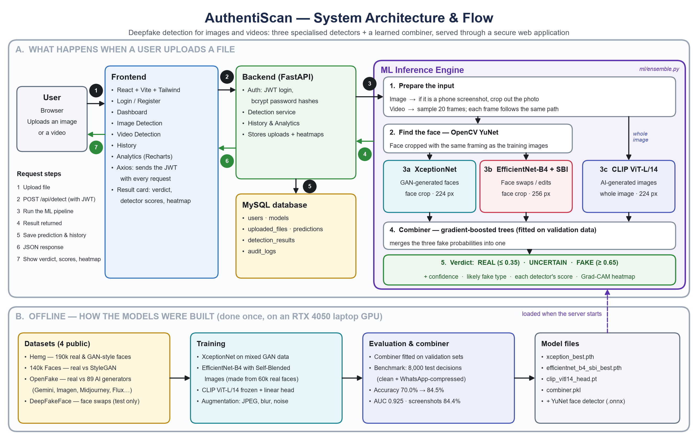

# AuthentiScan — Explainable Deepfake Detection for Images and Videos

*Deep Fake Detection System Using Deep Learning for Image and Video Authentication*

A full-stack deep learning system that detects manipulated images and videos — GAN-generated faces,
face swaps, and images from modern AI generators (Gemini, Imagen, GPT-image, Midjourney, Flux…). It
returns **REAL / UNCERTAIN / FAKE** with a confidence score and the likely type of fake, explains its
decision with Grad-CAM heatmaps and per-detector scores, and runs as a secure web application.

**Results** (8,000 held-out decisions across 4 kinds of fake, original + WhatsApp-compressed):
**84.5% accuracy / ROC-AUC 0.925**, versus 70.0% for the best single model.
Details: [docs/phase13_generalization.md](docs/phase13_generalization.md) ·
Paper: [docs/report/AuthentiScan_Research_Paper.pdf](docs/report/AuthentiScan_Research_Paper.pdf)

> Final-Year B.Tech (CSE) Major Project — Group 15, SRMS CET Bareilly.



---

## ✨ Key Features

| Category | Capability |
|----------|------------|
| Detection | **Image** and **video** detection: GAN faces, face swaps, AI-generated images |
| Default model | **Ensemble-DF** — XceptionNet (GAN faces) + EfficientNet-B4 trained with Self-Blended Images (face swaps) + CLIP ViT-L/14 linear probe (AI images), merged by a gradient-boosted combiner |
| Also selectable | ResNet50, EfficientNet-B0, XceptionNet (single-model comparison) |
| Verdicts | REAL / **UNCERTAIN** / FAKE + likely fake type + per-detector scores |
| Screenshots | Finds and analyses only the photo inside phone screenshots |
| Explainability | Grad-CAM heatmaps |
| Accounts & data | JWT login, prediction history, analytics dashboard, model comparison |

## 🏗️ Tech Stack

- **Frontend:** React, Vite, Tailwind CSS, React Router, Axios, Recharts
- **Backend:** FastAPI, Uvicorn, SQLAlchemy, Pydantic, JWT (python-jose), Passlib + bcrypt
- **Database:** MySQL 8
- **ML:** PyTorch, timm, OpenCLIP, OpenCV (YuNet face detector), Albumentations, scikit-learn

---

## 🚀 Setup (fresh clone)

Commands are for **Windows PowerShell**; Linux/macOS equivalents are noted where they differ.

### 0. Prerequisites

| Requirement | Version | Notes |
|---|---|---|
| Python | 3.10+ (tested 3.13) | |
| Node.js | 18+ (tested 22) | for the React frontend |
| MySQL Server | 8.x | the service must be running |
| Git | any | |
| NVIDIA GPU | optional | 6 GB+ recommended. Without one, the app runs on the CPU automatically (slower: a few seconds per image, much longer for videos) |
| Disk / internet | ~10 GB free | Python packages ≈ 5 GB; the CLIP model (≈ 1.7 GB) downloads on first start |

### 1. Clone and create `.env`

```powershell
git clone <repo-url>
cd Deepfake_finalyear
Copy-Item .env.example .env          # Linux/macOS: cp .env.example .env
python -c "import secrets; print(secrets.token_hex(32))"   # copy the output
```

Open `.env` and set:
- `DB_PASSWORD` — your MySQL root password
- `SECRET_KEY` — the random string printed above
- leave `DEFAULT_MODEL=ensemble`

### 2. Database

```powershell
mysql -u root -p -e "source database/schema.sql"       # run from the project folder; works on all systems
```

This creates `deepfake_db` with all tables and registers the models (including **Ensemble-DF**).

> **Already have `deepfake_db` from an older version?** Don't drop it — run these two statements instead:
> ```sql
> USE deepfake_db;
> ALTER TABLE predictions MODIFY verdict ENUM('real','fake','uncertain') NOT NULL;
> INSERT INTO models (name, architecture, weights_path, is_active)
>   VALUES ('Ensemble-DF','ensemble','ml/checkpoints/combiner.pkl',1);
> ```

### 3. Python environment

```powershell
python -m venv .venv
.\.venv\Scripts\Activate.ps1          # Linux/macOS: source .venv/bin/activate
pip install -r requirements.txt
```

**NVIDIA GPU (recommended):** the step above installs a CPU-only PyTorch. Replace it with the CUDA build:

```powershell
pip uninstall -y torch torchvision
pip install torch torchvision --index-url https://download.pytorch.org/whl/cu128
python -c "import torch; print(torch.cuda.is_available())"      # should print True
```

### 4. Trained model files (not in git)

The weights are too large for git. Download them from the repository's **Releases** page (or get them from
a team member) and place them in `ml/checkpoints/`:

| File | Size | Needed for |
|---|---|---|
| `xception_best.pth` | 80 MB | **required** — GAN-face detector |
| `efficientnet_b4_sbi_best.pth` | 68 MB | **required** — face-swap detector |
| `clip_vitl14_head.pt` | < 1 MB | **required** — AI-image detector head |
| `combiner.pkl` | < 1 MB | **required** — merges the three scores |
| `resnet50_best.pth`, `efficientnet_b0_best.pth` | 90 + 16 MB | optional — single-model comparison page |

The YuNet face detector (`ml/weights/`) is already in the repository. Datasets are **not** needed to run
the app — only to retrain (see [docs/phase13_generalization.md §13.10](docs/phase13_generalization.md)).

### 5. Run the backend

```powershell
cd backend
python -m uvicorn main:app --port 8000
```

On the **first start** the CLIP ViT-L/14 backbone (~1.7 GB) downloads automatically. Wait until the log
shows `[startup] ensemble models loaded` before the first detection.
API docs: <http://localhost:8000/docs>

### 6. Run the frontend (second terminal)

```powershell
cd frontend
npm install
npm run dev
```

Open **<http://localhost:5173>**. Vite forwards `/api` and `/storage` to the backend on port 8000.

### 7. First use

1. Click **Register** and create an account (the seeded admin user has a placeholder password).
2. Go to **Image Detection**, upload a face photo, an AI-generated image or a phone screenshot, and click
   **Detect**. The default model is the ensemble.
3. Check **History** and **Analytics**.

---

## 🛠️ Troubleshooting

| Problem | Fix |
|---|---|
| `Model weights not found` (503) | The four required files are missing from `ml/checkpoints/` (step 4) |
| `No active model for architecture 'ensemble'` | Old database — run the two SQL statements in step 2 |
| `Data truncated for column 'verdict'` | Same — run the `ALTER TABLE` statement in step 2 |
| First detection is very slow | Models are still loading; wait for `ensemble models loaded` |
| Want to force CPU on a GPU machine | Start the backend with `$env:DEVICE="cpu"; python -m uvicorn main:app --port 8000` |
| 500 error on register/login | `pip install bcrypt==4.0.1` (bcrypt 5.x breaks passlib) |
| `cv2` has no `FaceDetectorYN` / `CascadeClassifier` | `pip install opencv-python==4.10.0.84` |
| Can't connect to MySQL | Start the MySQL service and check `DB_PASSWORD` in `.env` |
| `ModuleNotFoundError: ml` | Start the backend from inside the `backend/` folder |
| CUDA errors while training | Stop the backend first — two processes sharing a 6 GB GPU can crash |

More details: [docs/SETUP.md](docs/SETUP.md).

---

## 📁 Repository Structure

```
Deepfake_finalyear/
├── backend/            FastAPI app (routers, services, ORM models, schemas, auth) — main.py
├── frontend/           React app (pages, components, API client)
├── database/           schema.sql — tables + seed data
├── ml/
│   ├── ensemble.py     3-detector ensemble inference (default model)
│   ├── inference.py    entry point used by the backend
│   ├── dataset/        loaders, YuNet face extraction, Self-Blended Images, screenshot cropping, downloaders
│   ├── models/         Xception, ResNet50, EfficientNet-B0/B4
│   ├── training/       train, mixed_train, sbi_train, clip_train
│   ├── evaluation/     benchmark, fit_combiner, screenshot_eval
│   ├── explain/        Grad-CAM
│   ├── weights/        YuNet face detector (in git)
│   └── checkpoints/    trained weights (NOT in git — see step 4)
├── docs/               documentation (phases 1–13), research paper, architecture diagram
└── requirements.txt
```

## 📚 Documentation

| Topic | Document |
|---|---|
| Detailed setup | [docs/SETUP.md](docs/SETUP.md) |
| Architecture & database | [docs/phase2_architecture.md](docs/phase2_architecture.md), [docs/phase3_database.md](docs/phase3_database.md) |
| ML pipeline (Stage 1) | [docs/phase4-7_ml_pipeline.md](docs/phase4-7_ml_pipeline.md), [docs/phase10_results.md](docs/phase10_results.md) |
| Ensemble, datasets, final results, how to retrain | [docs/phase13_generalization.md](docs/phase13_generalization.md) |
| Research paper | [docs/report/AuthentiScan_Research_Paper.pdf](docs/report/AuthentiScan_Research_Paper.pdf) |

## 📜 License

MIT — for academic and portfolio use. Datasets keep their own licences (e.g. OpenFake is CC-BY-NC-4.0).
