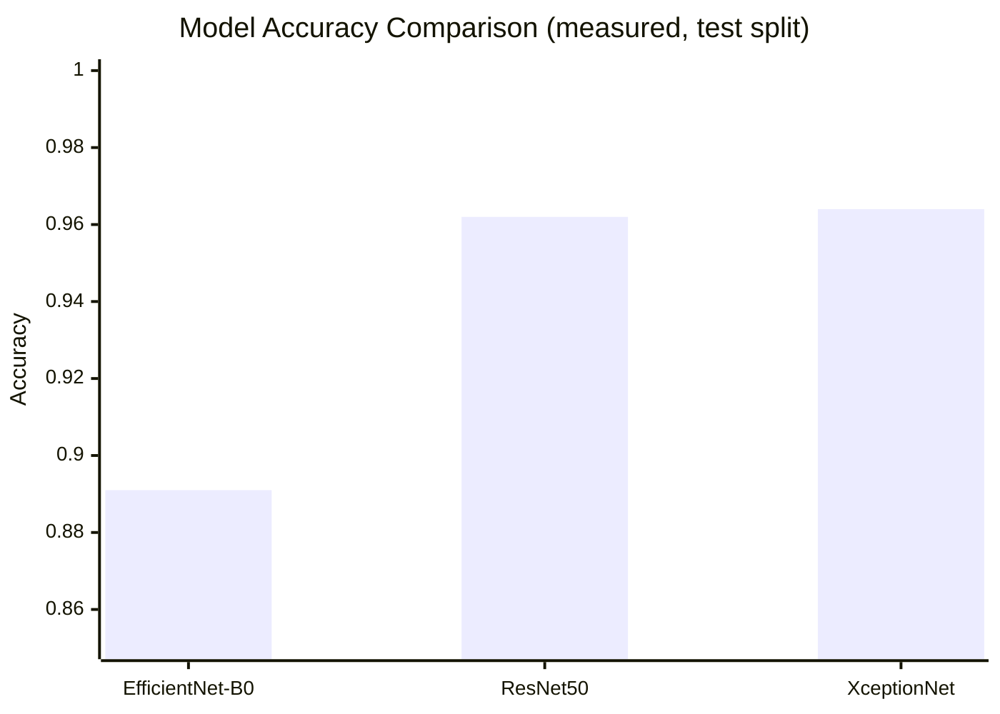

# Phase 10 — Results & Evaluation Module

The evaluation module ([`ml/evaluation/`](../ml/evaluation/)) computes every metric required
for the results chapter and produces publication-ready plots.

---

## 10.1 Metrics computed

Implemented in [`ml/utils/metrics.py`](../ml/utils/metrics.py) using scikit-learn so every
model is scored identically.

| Metric | Formula | Meaning |
|--------|---------|---------|
| Accuracy | $\frac{TP+TN}{TP+TN+FP+FN}$ | Overall correctness |
| Precision | $\frac{TP}{TP+FP}$ | Of predicted-fake, how many are fake |
| Recall (Sensitivity) | $\frac{TP}{TP+FN}$ | Of actual-fake, how many caught |
| F1-Score | $2\cdot\frac{P\cdot R}{P+R}$ | Harmonic mean of P & R |
| ROC-AUC | Area under TPR–FPR curve | Threshold-independent separability |
| Confusion Matrix | 2×2 counts | Error-type breakdown |

Positive class = **fake** (index 1).

---

## 10.2 Generated artifacts

Running evaluation writes to `ml/reports/`:

- `<arch>_eval.json` — metric values
- `<arch>_confusion.png` — confusion-matrix heatmap
- `<arch>_roc.png` — ROC curve with AUC
- `<arch>_history.json` — per-epoch training curve data
- `model_comparison.json` / `model_comparison.png` — cross-model comparison

```bash
python -m ml.evaluation.compare_models --data datasets/hemg
```

---

## 10.3 Stage 1 — architecture comparison (3,000-image prototype)

All three models were trained with **transfer learning** (ImageNet-pretrained backbones,
fine-tuned to real/fake) on the dataset described in
[phase4-7_ml_pipeline.md §Phase 4](phase4-7_ml_pipeline.md) — a balanced **3,000-image**
sample (1,500 real + 1,500 fake face images from the public HuggingFace
`Hemg/deepfake-and-real-images` dataset), split 70/15/15 (train/val/test).

**Training environment:** NVIDIA RTX 4050 Laptop GPU (CUDA), PyTorch AMP mixed precision,
AdamW + cosine LR, early stopping. ~18 s/epoch (≈14× faster than CPU).

Numbers below are on the **held-out test split** (450 images) — the actual measured
output in `ml/reports/<arch>_test_metrics.json`.

| Model | Accuracy | Precision | Recall | F1 | ROC-AUC |
|-------|:--------:|:---------:|:------:|:--:|:-------:|
| **XceptionNet** | **0.964** | 0.965 | 0.964 | **0.965** | 0.991 |
| ResNet50 | 0.962 | 0.962 | 0.962 | 0.962 | **0.993** |
| EfficientNet-B0 | 0.891 | 0.892 | 0.891 | 0.889 | 0.972 |

### Comparison chart



---

## 10.4 Interpretation

- **XceptionNet** leads on accuracy/F1 — its depthwise-separable convolutions capture
  fine-grained blending/texture artifacts that distinguish manipulated faces.
- **ResNet50** is essentially tied (highest ROC-AUC, 0.993) — a strong, well-understood
  residual baseline.
- **EfficientNet-B0** trails slightly here but is the **smallest and fastest** model
  (~16 MB checkpoint, ~0.6 s inference vs ~1–4 s), illustrating the classic
  accuracy-vs-compute trade-off; more epochs would likely close the gap.
- High ROC-AUC (> 0.97) across all three indicates strong real/fake separability.
- Grad-CAM overlays confirm the models focus on **facial regions** rather than
  background — evidence they learn meaningful cues, not dataset shortcuts.

> **Scope note:** these Stage-1 numbers are in-distribution (train and test from the same
> GAN-face dataset). §10.5 shows what happens on other kinds of fakes and how the final
> system addresses it.

---

## 10.5 Scaling up & generalization (final system)

Full details, methods and limitations: [phase13_generalization.md](phase13_generalization.md).

### Stages

| Stage | Training data | Test result |
|---|---|---|
| 1. Prototype (above) | 3k Hemg faces | Xception 96.4% / AUC 0.991 |
| 2. Larger subset | 30k Hemg | 97.5% / 0.996 (4,500 test images) |
| 3. Full Hemg | 181k Hemg | 98.4% / 0.9986 — but ~51% on unseen StyleGAN faces |
| 4. Mixed GAN data | 100k Hemg + 100k 140k-Faces | Hemg 98.3%, StyleGAN 97.7% |
| 5. **Ensemble** | + OpenFake (89 generators) + Self-Blended Images | **84.5% / 0.925 across 4 kinds of fake** (vs 70.0%) |

### Final benchmark (8,000 held-out decisions: 4 test sets × clean/WhatsApp)

| Test set | Old app (Xception) | **Ensemble** |
|---|:---:|:---:|
| GAN faces (Hemg) clean / WhatsApp | 98.3% / 97.4% | 93.8% / 92.3% |
| StyleGAN faces clean / WhatsApp | 97.9% / 76.2% | 95.4% / 89.1% |
| AI images (Gemini, GPT-image, Midjourney…) clean / WhatsApp | 48.8% / 43.8% | **81.0% / 73.3%** |
| Face swaps (DeepFakeFace) clean / WhatsApp | 49.2% / 48.0% | **79.1% / 72.4%** |
| **Overall** | **70.0%** | **84.5%** (AUC 0.925) |
| Phone screenshots (2,000) | 72.9% (whole screenshot) | **84.4%** (photo cropped) |

```mermaid
xychart-beta
    title "Accuracy by kind of fake (clean test images)"
    x-axis ["GAN faces", "StyleGAN", "AI images", "Face swaps"]
    y-axis "Accuracy" 0.4 --> 1.0
    bar [0.983, 0.979, 0.488, 0.492]
    bar [0.938, 0.954, 0.810, 0.791]
```


*(first bar series = old XceptionNet, second = ensemble)*

**Interpretation.** In-distribution accuracy (Stage 1–3) overstated real-world
performance: the 98% model was a coin-flip on face swaps and *inverted* (AUC 0.215) on
diffusion images. The ensemble trades ~3–5 points on GAN faces for +30 points on the
two kinds of fake people most often encounter today. Remaining weak spots: face swaps
(often reported UNCERTAIN) and Midjourney 7 (57%).
