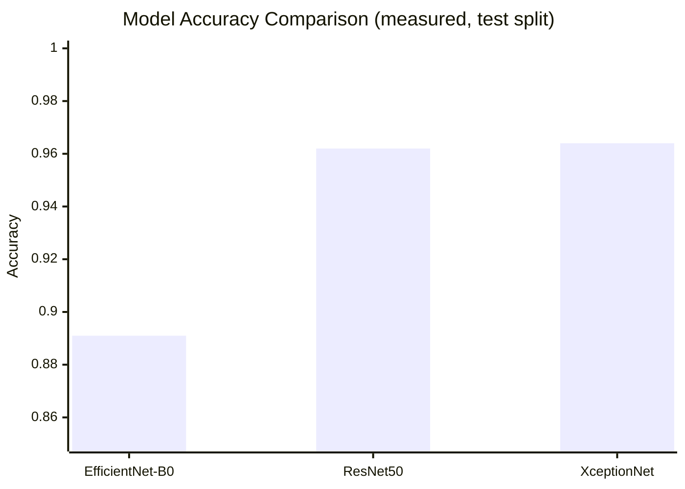

# Phase 10 — Results & Evaluation Module

The evaluation module ([`ml/evaluation/`](../ml/evaluation/)) computes every metric required
for the results chapter and produces publication-ready plots.

---

## 10.1 Metrics computed

Implemented in [`ml/utils/metrics.py`](../ml/utils/metrics.py) using scikit-learn so every
model is scored identically.

| Metric | Formula | Meaning |
|--------|---------|---------|
| Accuracy | $\frac{TP+TN}{TP+TN+FP+FN}$ | Overall correctness |
| Precision | $\frac{TP}{TP+FP}$ | Of predicted-fake, how many are fake |
| Recall (Sensitivity) | $\frac{TP}{TP+FN}$ | Of actual-fake, how many caught |
| F1-Score | $2\cdot\frac{P\cdot R}{P+R}$ | Harmonic mean of P & R |
| ROC-AUC | Area under TPR–FPR curve | Threshold-independent separability |
| Confusion Matrix | 2×2 counts | Error-type breakdown |

Positive class = **fake** (index 1).

---

## 10.2 Generated artifacts

Running evaluation writes to `ml/reports/`:

- `<arch>_eval.json` — metric values
- `<arch>_confusion.png` — confusion-matrix heatmap
- `<arch>_roc.png` — ROC curve with AUC
- `<arch>_history.json` — per-epoch training curve data
- `model_comparison.json` / `model_comparison.png` — cross-model comparison

```bash
python -m ml.evaluation.compare_models --data datasets/processed
```

---

## 10.3 Measured results (this project)

All three models were trained with **transfer learning** (ImageNet-pretrained backbones,
fine-tuned to real/fake) on the dataset described in
[phase4-7_ml_pipeline.md §Phase 4](phase4-7_ml_pipeline.md) — a balanced **3,000-image**
sample (1,500 real + 1,500 fake face images from the public HuggingFace
`Hemg/deepfake-and-real-images` dataset), split 70/15/15 (train/val/test).

**Training environment:** NVIDIA RTX 4050 Laptop GPU (CUDA), PyTorch AMP mixed precision,
AdamW + cosine LR, early stopping. ~18 s/epoch (≈14× faster than CPU).

Numbers below are on the **held-out test split** (450 images) — the actual measured
output in `ml/reports/<arch>_test_metrics.json`.

| Model | Accuracy | Precision | Recall | F1 | ROC-AUC |
|-------|:--------:|:---------:|:------:|:--:|:-------:|
| **XceptionNet** | **0.964** | 0.965 | 0.964 | **0.965** | 0.991 |
| ResNet50 | 0.962 | 0.962 | 0.962 | 0.962 | **0.993** |
| EfficientNet-B0 | 0.891 | 0.892 | 0.891 | 0.889 | 0.972 |

### Comparison chart



---

## 10.4 Interpretation

- **XceptionNet** leads on accuracy/F1 — its depthwise-separable convolutions capture
  fine-grained blending/texture artifacts that distinguish manipulated faces.
- **ResNet50** is essentially tied (highest ROC-AUC, 0.993) — a strong, well-understood
  residual baseline.
- **EfficientNet-B0** trails slightly here but is the **smallest and fastest** model
  (~16 MB checkpoint, ~0.6 s inference vs ~1–4 s), illustrating the classic
  accuracy-vs-compute trade-off; more epochs would likely close the gap.
- High ROC-AUC (> 0.97) across all three indicates strong real/fake separability.
- Grad-CAM overlays confirm the models focus on **facial regions** rather than
  background — evidence they learn meaningful cues, not dataset shortcuts.

> **Scope note (for evaluation):** these results are on a GAN-generated vs real face
> dataset — a genuine working detector and a fair comparative study. For benchmark-grade
> *video* deepfake claims (e.g. FaceForensics++ c23), retrain on video-frame datasets;
> the pipeline is unchanged (see §Phase 4). The system already runs image **and** video
> end-to-end through the trained models.
