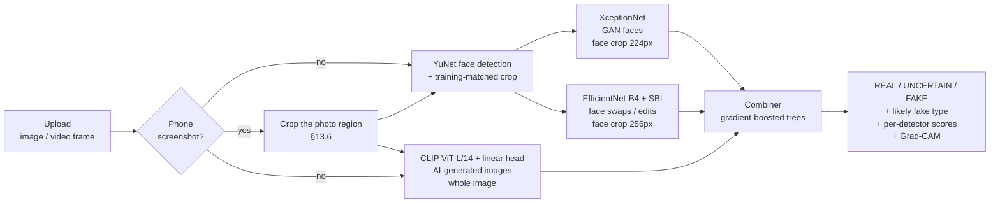

# Phase 13 — Scaling Up & Generalization (Ensemble Detector)

This chapter documents the second half of the project: what happened when the
original detector met real-world inputs, and how the system was rebuilt to handle
them. Every number below was measured on held-out test images and is reproducible
with the commands in §13.10.

---

## 13.1 Motivation — where the original detector failed

The Phase 10 models were trained on a 3,000-image GAN-face sample and scored
~96% on its test split. After the dataset was scaled up (§13.2), the best
XceptionNet reached 98% — but hands-on testing with real uploads exposed three
failure modes that in-distribution accuracy hid:

| Input people actually upload | Old XceptionNet | Why it failed |
|---|:---:|---|
| Images from modern generators (Gemini, Imagen, GPT-image, Midjourney, Flux) | 48.8% acc, **AUC 0.215** | Trained only on GAN faces. AUC below 0.5 means it ranks *real* photos as more fake than diffusion images — it learned "slightly unusual = fake", and diffusion output is unusually *clean*. |
| Face swaps (a real photo with another face blended in) | 49.2% acc, AUC 0.522 | Never saw a blended face; coin-flip. |
| Phone screenshots / WhatsApp-forwarded copies | 73% on screenshots | The status bar, captions and buttons were analysed as if they were the image. |

Conclusion: **high accuracy on one dataset ≠ a useful detector.** The rest of
this chapter is about generalization.

---

## 13.2 Stage-by-stage progression

| Stage | Training data | Model | Result (held-out test) |
|---|---|---|---|
| 1. Prototype (Phase 10) | 3k Hemg faces | XceptionNet | 96.4% acc, AUC 0.991 (450 images) |
| 2. Larger subset | 30k Hemg faces | XceptionNet (fine-tuned) | 97.5%, AUC 0.996 (4,500 images) |
| 3. Full Hemg | 181k Hemg faces | XceptionNet (fine-tuned) | 98.4%, AUC 0.9986 (4,500) — but **~51% on 140k StyleGAN faces** |
| 4. Mixed GAN data | 100k Hemg + 100k 140k-Faces | XceptionNet (fine-tuned) | Hemg 98.3%, 140k **97.7%** (20,000 images) |
| 5. **Ensemble (final)** | + OpenFake + Self-Blended Images | Xception + EfficientNet-B4 (SBI) + CLIP ViT-L/14 + combiner | **84.5% overall, AUC 0.925** on a 4-domain benchmark (§13.8) — up from 70.0% |

Stage 4 shows the first lesson: training on a second GAN family lifted the unseen
StyleGAN accuracy from ~51% to 97.7% while costing only 0.1 points on Hemg.
Stage 5 applies the same lesson to entirely different *kinds* of fakes.

Also fixed along the way: the inference face crop was tighter than the training
images' framing, which made the model call **47% of real faces fake**
(75.8% vs 97.8% accuracy on the same images). Inference now crops at the
training framing (`CONFIG.infer_face_ratio`).

---

## 13.3 Final architecture — three specialists + a learned combiner

Different fakes leave different evidence, so one detector per kind of fake is
trained, and a small model learns how much to trust each.



| Component | Model | Detects | Evidence it uses |
|---|---|---|---|
| GAN-face detector | XceptionNet (Stage 4 weights) | Fully synthesised GAN faces | High-frequency GAN fingerprints in the face |
| Face-swap detector | EfficientNet-B4 (Noisy-Student) trained with Self-Blended Images | Face swaps, face edits | Blending boundary, colour mismatch, slight misalignment |
| AI-image detector | Frozen CLIP ViT-L/14 + linear classifier | Diffusion / autoregressive images (Gemini, Imagen, GPT-image, Midjourney, Flux, SD…) | Global "natural photo vs generated" statistics in CLIP's feature space |
| Combiner | HistGradientBoosting (depth 3) on the 3 probabilities | — | Learns when to trust which detector |
| Face detector | OpenCV YuNet (replaced Haar) | — | Finds more faces and gives 5 landmarks |

**Why not one model for everything?** Measured, not assumed: XceptionNet scored
AUC 0.215 on diffusion images — the cues it learned for GAN faces point the wrong
way for diffusion images. The detectors also need different inputs (face crop vs
whole image). With one 6 GB GPU and limited data, specialists plus a combiner is
the stronger design; it is also standard practice in the deepfake literature.

---

## 13.4 Data

| Dataset | Source | Used for | Size used |
|---|---|---|---|
| Hemg deepfake-and-real-images | Hugging Face (public) | Xception training; real faces for SBI; test/val | 190k images (181k train) |
| 140k Real and Fake Faces | Kaggle (FFHQ real vs StyleGAN) | Xception training; real faces for SBI; test/val | 100k train, official valid/test |
| OpenFake (McGill, CC-BY-NC-4.0) | Hugging Face `ComplexDataLab/OpenFake` | CLIP detector training; test/val | 6,462 train / 1,018 val / 1,776 test from **89 generators** |
| DeepFakeFace (OpenRAIL) | Hugging Face `OpenRL/DeepFakeFace` | **Test/validation only** — never trained on | 30k real celebrity photos + 30k InsightFace swaps |

OpenFake is 3.4 TB in full, so only individual parquet row groups were streamed
from many different shards (`ml/dataset/fetch_openfake.py`). Every image — real
and fake alike — was resized to a 256 px short side and re-saved as JPEG. This
removes a shortcut: originals differ in format (real ≈ JPEG, fake ≈ large PNG),
and a detector could otherwise learn "PNG = fake".

---

## 13.5 The three detectors

### 13.5.1 Face-swap detector — Self-Blended Images (SBI)
Shiohara & Yamasaki (CVPR 2022). The model never sees a real face swap. Instead,
each **real** face is turned into a pseudo-swap: a slightly altered copy of itself
(colour / sharpness / ±5% scale / ±3% shift) is blended back through a soft,
randomly deformed face mask (`ml/dataset/sbi.py`). The pair (real, self-blended)
teaches the generic artefacts every swap leaves — the blending boundary — so the
model transfers to swap tools it has never seen.

- Data: 60,000 real faces (30k Hemg + 30k FFHQ), held-out sets excluded.
- Model: EfficientNet-B4 (`tf_efficientnet_b4.ns_jft_in1k`), 256 px, AdamW, OneCycle LR,
  3 epochs (174,564 pairs), AMP.
- Real-world robustness: both images of each pair get random JPEG (q30–95),
  downscaling, blur and noise.
- Validation (held-out self-blended pairs): 95.1% acc, AUC 0.989.
- **Unseen InsightFace swaps (DeepFakeFace): 77.6% acc, AUC 0.888.**

Our variant builds the mask from YuNet's 5 landmarks (the paper used 81 dlib
landmarks) — a known simplification.

### 13.5.2 AI-image detector — CLIP linear probe (UnivFD)
Ojha et al. (CVPR 2023): a frozen CLIP ViT-L/14 maps each image to a 768-d
feature vector; only a linear classifier is trained. CLIP's features come from
400M image–text pairs and are not specialised to any one generator, so the
detector transfers far better than a CNN trained from scratch.

- Training: 6,462 OpenFake images + 4,000 GAN-face images, each embedded twice
  (clean + randomly degraded) → 20,924 feature vectors.
- Classifier: standardized logistic regression (C chosen on validation), folded
  into one linear layer for serving.
- **OpenFake test (1,776 images, 89 generators): 88.7% acc, AUC 0.961.**

Per generator (test split, largest groups):

| Source | Accuracy | n |
|---|:---:|:---:|
| Real photos | 95% | 876 |
| GPT-image-1.5 | 94% | 109 |
| Illustrious (SDXL anime) | 98% | 116 |
| Z-Image-Turbo | 81% | 250 |
| Flux.2-klein-9B | 78% | 176 |
| Veo-3 (video frames) | 82% | 38 |
| GPT-image-2 | 88% | 16 |
| Gemini nano-banana-pro | 80% | 10 |
| **Midjourney 7** | **57%** | 68 |

### 13.5.3 GAN-face detector — XceptionNet
Unchanged from Stage 4 (mixed Hemg + 140k training). Clean test: Hemg 98.3%,
140k 97.9%.

### 13.5.4 Combiner
A gradient-boosted tree model (scikit-learn `HistGradientBoostingClassifier`,
depth 3, 200 iterations) takes the three fake-probabilities and outputs one.
Trees, rather than a weighted average, can learn rules such as "trust
XceptionNet when it is very confident even if CLIP disagrees". It is fitted
**only on validation images** (Hemg val, 140k valid, OpenFake validation, and a
DeepFakeFace subset disjoint from the test subset; each clean and
WhatsApp-degraded — 7,962 samples) — `ml/evaluation/fit_combiner.py`.

---

## 13.6 Screenshot handling

`ml/dataset/screenshot.py` finds the photo inside a phone screenshot so only
that region is analysed:

1. **Is it a screen?** Phone screenshots are tall (≥1.7:1) or large desktop
   captures; ordinary photos are skipped.
2. **Background colour** = the most common colour (app UI is one flat colour).
3. **Photo rows** = rows where most pixels are *not* background and there is a
   real mix of colours (text, buttons and header bars fail this); the tallest
   block of such rows is kept, then the same for columns.
4. **Sanity checks:** region area 8–85% of the screen, ≥300 distinct colours, and
   the surroundings must be perfectly flat UI.

Measured on synthetic phone screenshots with known photo positions
(`make_fake_screenshot`): photo found in **94.3%** of screenshots, mean IoU
≈0.90, and **0 of 400 ordinary photos wrongly cropped**.

---

## 13.7 Other changes

| Change | Why |
|---|---|
| **UNCERTAIN verdict** (fake probability 0.35–0.65) | Out-of-distribution inputs land in the middle; saying "not sure" is more honest than a confident wrong answer. DB enum, API, History filter, Analytics and UI updated. |
| **Likely fake type** in results | The detector with the highest score names the type: *GAN-generated face*, *Face swap / face edit* or *AI-generated image*. |
| **Per-detector score bars** in the result card | Lets the user see *why* — e.g. a face swap shows a high face-swap bar even when the verdict is UNCERTAIN. |
| **YuNet face detector** | Found faces in ~95% of Hemg images vs ~81% for the Haar cascade; also provides landmarks for SBI. |
| **Model warm-up at backend start** | First request ~3 s instead of ~20 s. |
| **Augmentation fix** | `transforms.py` used argument names removed in Albumentations 2.x, so noise/JPEG augmentation silently ran with defaults; corrected. |

---

## 13.8 Evaluation protocol & results

**Protocol.** Four test sets, 500 real + 500 fake each, none used for training or
for fitting the combiner. Each is scored **clean** and **WhatsApp-degraded**
(downscale + JPEG q50) → 8,000 test decisions. Splits are fixed by seed and
re-checked to be identical across runs.

| Test set | Kind of fake |
|---|---|
| hemg | GAN faces (Hemg held-out test split) |
| 140k | StyleGAN faces (official test split) |
| openfake | 89 diffusion / autoregressive generators (official test split) |
| dff_swap | InsightFace face swaps of real celebrities (DeepFakeFace) |

### Individual detectors (accuracy / ROC-AUC)

| Detector | hemg | 140k | openfake | dff_swap |
|---|---|---|---|---|
| XceptionNet (clean) | **98.3% / 0.999** | **97.9% / 0.998** | 48.8% / 0.215 | 49.2% / 0.522 |
| SBI EfficientNet-B4 (clean) | 65.1% / 0.678 | 48.7% / 0.445 | 47.7% / 0.354 | **77.6% / 0.888** |
| CLIP ViT-L/14 (clean) | 78.8% / 0.870 | 87.1% / 0.947 | **86.9% / 0.960** | 65.8% / 0.732 |
| XceptionNet (WhatsApp) | 97.4% / 0.998 | 76.2% / 0.962 | 43.8% / 0.203 | 48.0% / 0.441 |
| SBI EfficientNet-B4 (WhatsApp) | 57.8% / 0.618 | 47.1% / 0.392 | 49.4% / 0.405 | 65.2% / 0.723 |
| CLIP ViT-L/14 (WhatsApp) | 74.8% / 0.823 | 77.5% / 0.855 | 83.3% / 0.966 | 69.9% / 0.759 |

Each detector is strong exactly where it was designed to be and weak elsewhere —
the case for combining them.

### Final system (ensemble) vs original

| Test set | Old app (XceptionNet) | **Ensemble** | Ensemble AUC |
|---|:---:|:---:|:---:|
| hemg clean / WhatsApp | 98.3% / 97.4% | 93.8% / 92.3% | 0.989 / 0.976 |
| 140k clean / WhatsApp | 97.9% / 76.2% | 95.4% / **89.1%** | 0.993 / 0.962 |
| openfake clean / WhatsApp | 48.8% / 43.8% | **81.0% / 73.3%** | 0.934 / 0.952 |
| dff_swap clean / WhatsApp | 49.2% / 48.0% | **79.1% / 72.4%** | 0.873 / 0.800 |
| **All 8,000** | **70.0%** | **84.5%** | **0.925** |

- False alarms on real images: 10.7% → **8.6%**.
- 13.4% of inputs are reported UNCERTAIN; on the rest accuracy is **89.1%**.
- Trade-off: GAN-face accuracy drops ~3–5 points because the new detectors
  sometimes flag real Hemg photos; overall the gain is large.

### Screenshots

2,000 synthetic phone screenshots of the test images (half also JPEG q70):

| Test set | Ensemble on whole screenshot | **Ensemble with photo cropping** |
|---|:---:|:---:|
| hemg | 78.2% (AUC 0.87) | **93.6%** (0.99) |
| 140k | 73.4% (0.84) | **93.8%** (0.98) |
| openfake | 65.0% (0.68) | **73.8%** (0.91) |
| dff_swap | 75.0% (0.83) | 76.2% (0.84) |
| **All** | **72.9%** (0.81) | **84.4%** (0.93) |

With cropping, screenshots score the same as clean uploads (84.4% vs 84.5%).

---

## 13.9 Limitations (honest)

- **Face swaps** are the weakest category (72–79%) and often come out UNCERTAIN;
  screenshots barely help them because compression erases blending traces.
  Real face-swap training data (Celeb-DF / FaceForensics++) is the planned fix.
- **Midjourney 7** (57%) and some newer generators remain hard; only 6.5k of
  OpenFake's 2.3M images were used, limited by a mobile-data connection.
- **Unseen future generators** will reduce accuracy — true of every detector.
- **Video** is analysed frame-by-frame (no temporal model) and has not yet been
  evaluated on real deepfake videos.
- **Screenshot results** use synthetic screenshots; real app layouts vary.
- SBI uses 5-landmark masks instead of the paper's 81, and 3 training epochs
  instead of 100 (hardware-limited).

---

## 13.10 Reproduce

```powershell
# data
python -m ml.dataset.fetch_hf_full --out datasets/hemg                         # Hemg (~1.8 GB download)
python -m ml.dataset.fetch_openfake --out datasets/openfake --train 6500 --val 1000 --test 4000
#   DeepFakeFace: insight.zip + wiki.zip from huggingface.co/datasets/OpenRL/DeepFakeFace -> datasets/dff/

# detectors
python -m ml.training.mixed_train --resume ml/checkpoints/xception_best.pth      # GAN faces (Stage 4)
python -m ml.training.sbi_train --per-source 30000 --epochs 3                     # face swaps
python -m ml.training.clip_train                                                  # AI images

# evaluation + combiner
python -m ml.evaluation.benchmark --detectors xception sbi clip
python -m ml.evaluation.fit_combiner
python -m ml.evaluation.screenshot_eval --n 250
```

Outputs: weights in `ml/checkpoints/`, metrics in `ml/reports/`
(`benchmark.json`, `ensemble_test_metrics.json`, `screenshot_eval.json`,
`clip_per_generator.json`).

> Stop the backend before running GPU training/evaluation scripts — two processes
> sharing the 6 GB GPU caused a CUDA crash during development.
