# Phase 2 — System Architecture

All diagrams use **Mermaid** and render directly on GitHub / VS Code.

---

## 2.1 High-Level Architecture

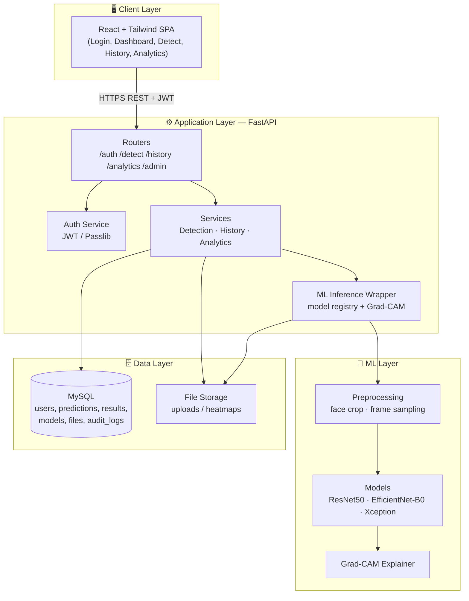

---

## 2.2 Low-Level Architecture (Backend Modules)

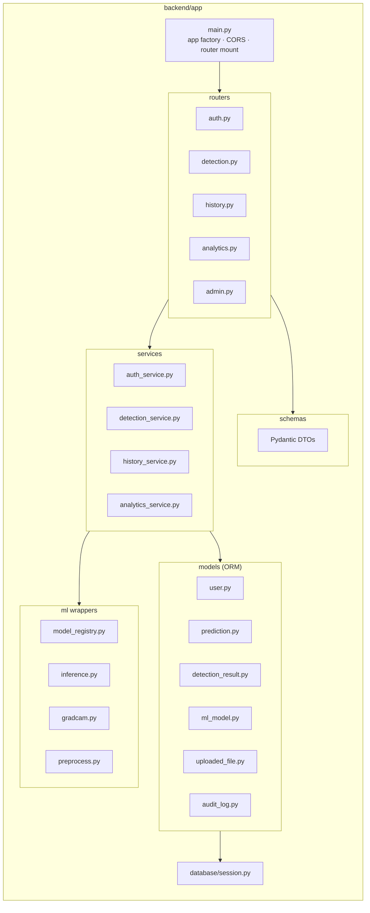

---

## 2.3 Component Diagram

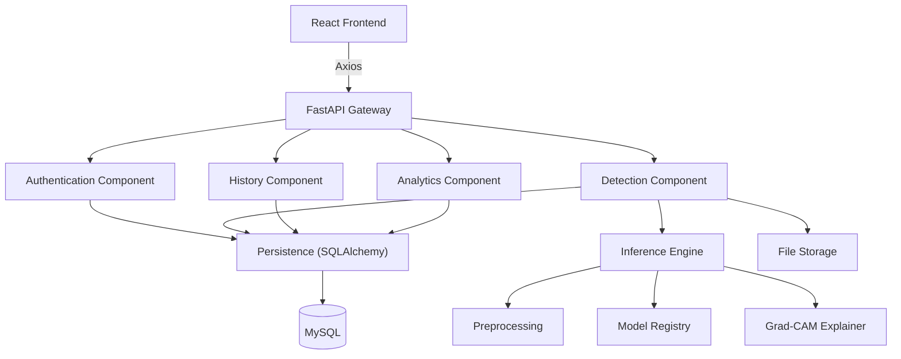

---

## 2.4 Class Diagram (Domain / ORM)

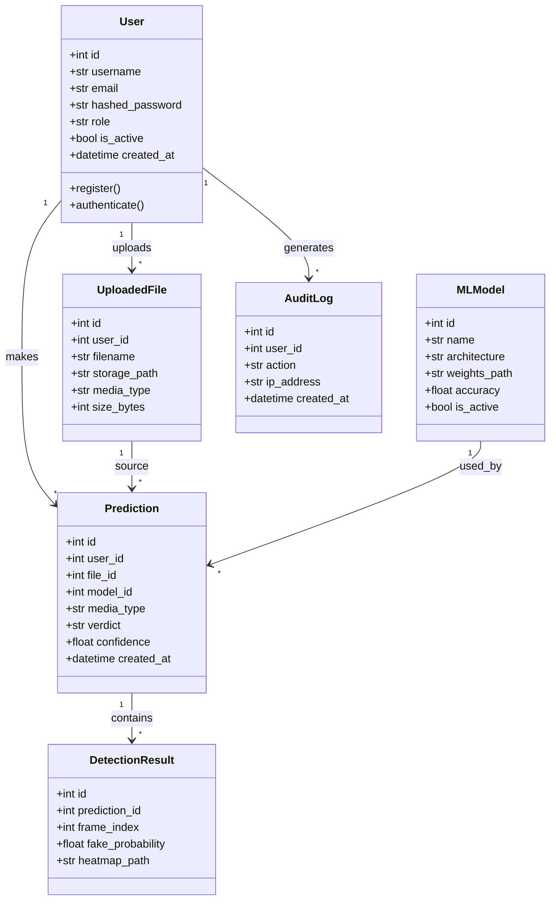

---

## 2.5 Sequence Diagram — Image Detection

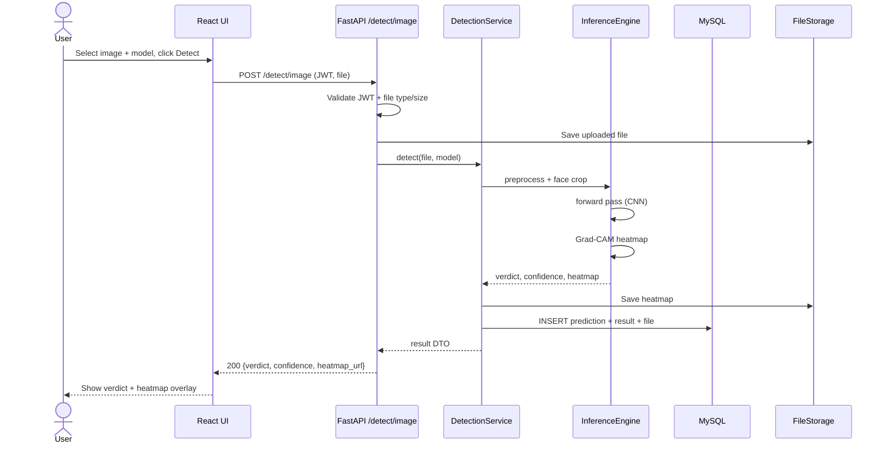

---

## 2.6 Sequence Diagram — Video Detection

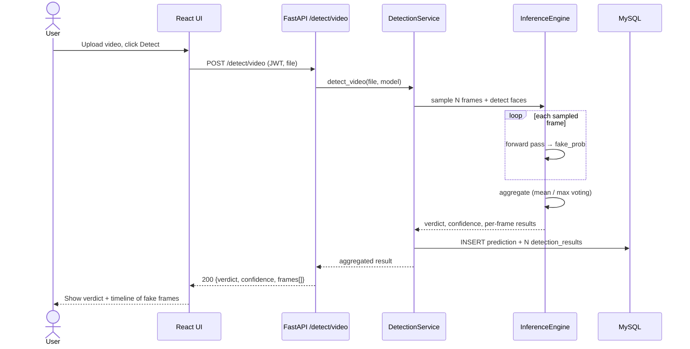

---

## 2.7 Activity Diagram — Detection Flow

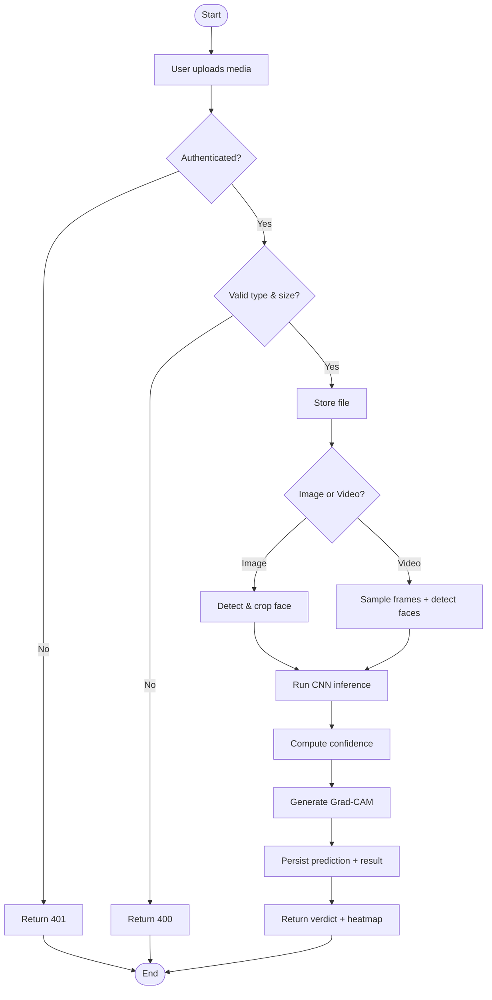

---

## 2.8 Use Case Diagram

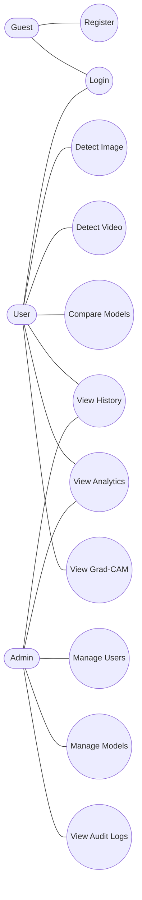

---

## 2.9 Data Flow Diagrams

### DFD Level 0 (Context)

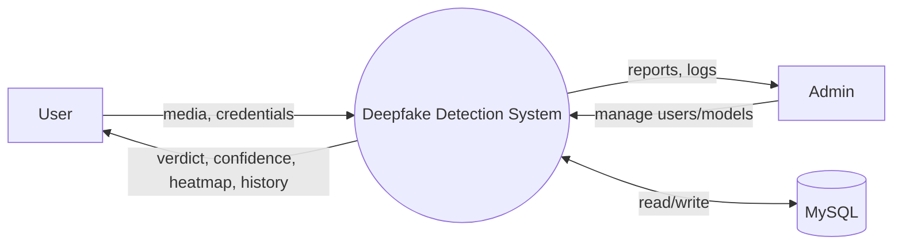

### DFD Level 1

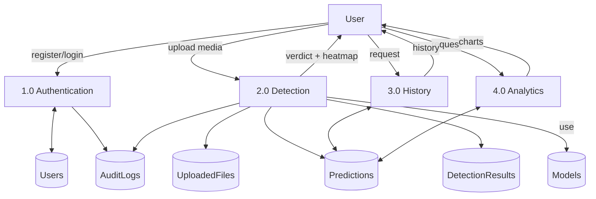

### DFD Level 2 (Detection Process — expand 2.0)

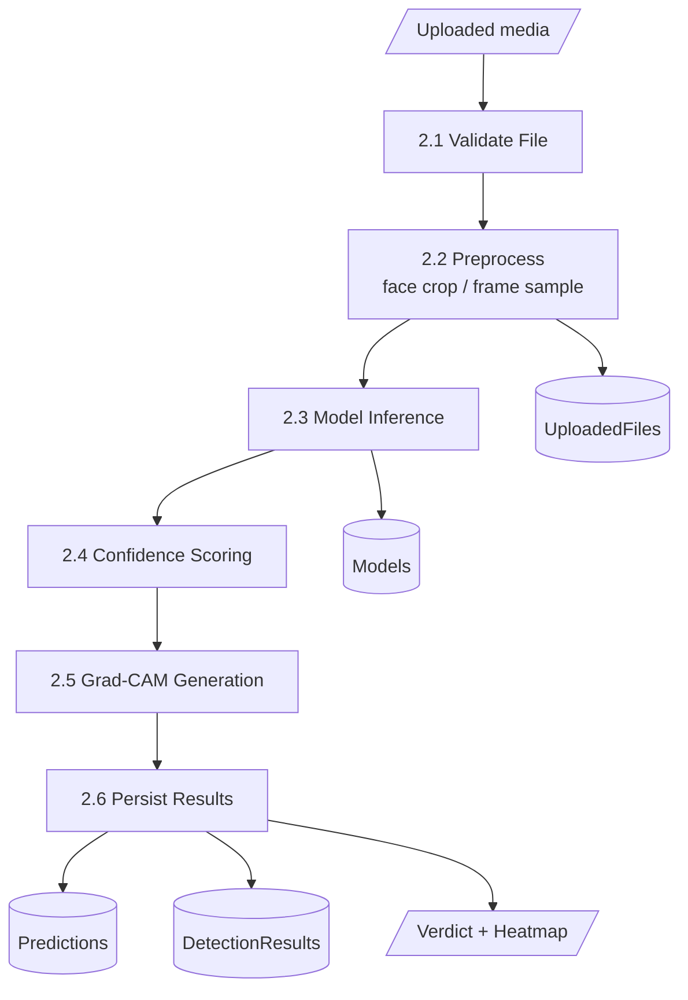
