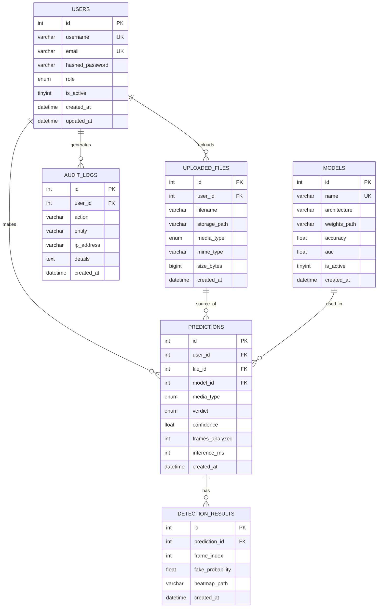

# Phase 3 — Database Design (MySQL)

Engine: **MySQL 8 / InnoDB**, `utf8mb4`. Full runnable script: [`database/schema.sql`](../database/schema.sql).

---

## 3.1 Entity–Relationship Diagram

---

## 3.2 Tables & Columns

### `users`
| Column | Type | Constraints |
|--------|------|-------------|
| id | INT | PK, AUTO_INCREMENT |
| username | VARCHAR(50) | UNIQUE, NOT NULL |
| email | VARCHAR(120) | UNIQUE, NOT NULL |
| hashed_password | VARCHAR(255) | NOT NULL |
| role | ENUM('user','admin') | DEFAULT 'user' |
| is_active | TINYINT(1) | DEFAULT 1 |
| created_at / updated_at | DATETIME | auto timestamps |

### `uploaded_files`
Stores metadata of each uploaded media file (never the raw blob — kept on disk).

### `models`
Registry of trained detectors (ResNet50, EfficientNet-B0, Xception) with metrics + weights path.

### `predictions`
One row per detection request: links user → file → model, stores final verdict & confidence.

### `detection_results`
Per-frame (video) or per-face (image) breakdown incl. Grad-CAM heatmap path.

### `audit_logs`
Security/audit trail of key actions (login, upload, admin operations).

---

## 3.3 Relationships & Cardinality

| Relationship | Type | On Delete |
|--------------|------|-----------|
| users → uploaded_files | 1 : N | CASCADE |
| users → predictions | 1 : N | CASCADE |
| users → audit_logs | 1 : N | SET NULL |
| uploaded_files → predictions | 1 : N | CASCADE |
| models → predictions | 1 : N | RESTRICT |
| predictions → detection_results | 1 : N | CASCADE |

---

## 3.4 Constraints & Indexing Strategy

- **Primary keys** on every `id`.
- **Unique** on `users.username`, `users.email`, `models.name`.
- **Foreign keys** enforce referential integrity (see On Delete rules).
- **CHECK** `confidence BETWEEN 0 AND 1`, `fake_probability BETWEEN 0 AND 1`.
- **Indexes** on all FK columns and on `predictions.created_at`, `predictions.verdict`
  to speed up history filtering and analytics aggregation.
