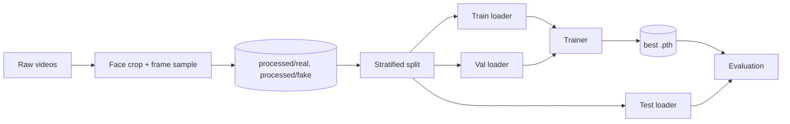
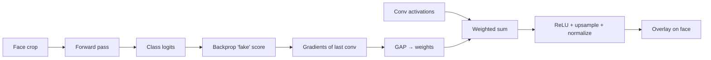

# Phases 4–7 — Dataset, ML Pipeline, Models & Explainable AI

This document covers the machine-learning side of the system. All code lives under `ml/`
and is importable as a package (`from ml...`), so **run every command from the project root**.

---

## Phase 4 — Dataset Module

### Dataset actually used (this project)
| Dataset | Content | Access |
|---------|---------|--------|
| **`Hemg/deepfake-and-real-images`** (HuggingFace) | Real vs AI-generated/deepfake face **images** (labels: Real / Fake) | Public — no access form |

A **balanced 3,000-image** sample was used: **1,500 real + 1,500 fake**, pulled directly
via the public HuggingFace datasets-server (no credentials) by
[`ml/dataset/fetch_hf_sample.py`](../ml/dataset/fetch_hf_sample.py). Images are already
face-centric; the pipeline still runs a face-crop + resize before training.

```bash
# Pull a balanced sample into datasets/processed/{real,fake}
python -m ml.dataset.fetch_hf_sample --per-class 1500 --only-label 0 --start-offset 0
python -m ml.dataset.fetch_hf_sample --per-class 1500 --only-label 1 --start-offset 95000
python -m ml.dataset.validator --root datasets/processed
```
> In this dataset the split is ordered (Fake ≈ offsets 0–95k, Real ≈ 95k+), so each class
> is fetched from an offset where it is present.

### Supported benchmarks (for scale-up / video)
The system also ships a video-preprocessing path for the standard benchmarks, which are
license-gated (kept for future work / video-grade training):

| Dataset | Content | Access |
|---------|---------|--------|
| **FaceForensics++** | 1000 real + manipulated (DF, F2F, FS, NT) videos | Google form → download script |
| **Celeb-DF v2** | 590 real + 5639 high-quality fake celebrity videos | Request form |
| **DFDC** | 100k+ clips from the Kaggle challenge | Kaggle / Meta license |

### Files
- [`ml/dataset/fetch_hf_sample.py`](../ml/dataset/fetch_hf_sample.py) — downloads a balanced
  real/fake **image** sample from HuggingFace (the dataset used here).
- [`ml/dataset/downloader.py`](../ml/dataset/downloader.py) — prints official access
  instructions for the license-gated **video** benchmarks above.
- [`ml/dataset/preprocess.py`](../ml/dataset/preprocess.py) — converts raw **videos** + a
  `labels.csv` into a flat `datasets/processed/{real,fake}/` image folder using face crops.
- [`ml/dataset/validator.py`](../ml/dataset/validator.py) — checks class presence,
  corrupt images and class balance before training.

### Video-benchmark workflow (optional)
```bash
python -m ml.dataset.downloader --dataset faceforensics --info
# (manually download videos into datasets/raw/faceforensics/)
python -m ml.dataset.preprocess --videos-dir datasets/raw/faceforensics \
    --labels datasets/raw/faceforensics/labels.csv --out datasets/processed --frames 15
```

---

## Phase 5 — ML Pipeline

```
ml/
├── config.py                 # all hyper-parameters & paths
├── dataset/
│   ├── transforms.py         # Albumentations augmentation + eval transforms
│   ├── face_extraction.py    # OpenCV face crop, frame sampling
│   ├── dataset.py            # Dataset + stratified train/val/test DataLoaders
│   ├── preprocess.py         # video → face-image pipeline
│   └── validator.py
├── models/                   # (Phase 6)
├── training/train.py         # training loop
├── evaluation/               # (Phase 10)
├── explain/gradcam.py        # (Phase 7)
├── inference.py              # unified predict_image / predict_video
└── utils/                    # seed, logger, metrics
```

### Pipeline stages
1. **Preprocessing** — face detection & crop (Haar cascade); frame sampling for video.
2. **Augmentation** — flips, shifts, JPEG compression, noise, colour jitter
   (chosen to preserve forensic artifacts while improving robustness).
3. **Splitting** — stratified 70/15/15 train/val/test via scikit-learn.
4. **Training** — AdamW + cosine LR, AMP mixed precision, early stopping, best-checkpoint.
5. **Validation** — per-epoch accuracy/AUC/F1 on the val split.
6. **Testing** — final metrics on the held-out test split with the best weights.

### Data-flow



---

## Phase 6 — Model Implementation

Three detectors share a common `BaseDetector` interface (SOLID: they are
interchangeable). Built via a **factory** so the training/inference code never
depends on a concrete class.

| Model | File | Backbone | Grad-CAM target |
|-------|------|----------|-----------------|
| ResNet50 | [`ml/models/resnet50_model.py`](../ml/models/resnet50_model.py) | torchvision ResNet50 | `layer4[-1]` |
| EfficientNet-B0 | [`ml/models/efficientnet_model.py`](../ml/models/efficientnet_model.py) | timm efficientnet_b0 | `conv_head` |
| XceptionNet | [`ml/models/xception_model.py`](../ml/models/xception_model.py) | timm xception | `bn4` |

All heads are re-initialized to 2 classes (real/fake) with dropout regularization.

> **Grad-CAM target note:** XceptionNet uses the final batch-norm feature map (`bn4`) rather
> than the following activation (`act4`). timm's xception uses *in-place* ReLUs, and
> registering a backward hook on an in-place op breaks autograd (view + in-place conflict).
> `bn4` gives the same spatial feature map without that issue.

### Train & evaluate
The repo provides two convenience launchers on top of `ml/training/train.py`:
[`train_gpu.py`](../ml/training/train_gpu.py) (CUDA, AMP on) and
[`train_cpu.py`](../ml/training/train_cpu.py) (CPU-safe: workers=0, AMP off).

```bash
# Train each model on GPU (used in this project; ~18 s/epoch on RTX 4050)
python -m ml.training.train_gpu --arch xception        --epochs 15
python -m ml.training.train_gpu --arch resnet50        --epochs 15
python -m ml.training.train_gpu --arch efficientnet_b0 --epochs 15

# CPU fallback (no GPU): fewer epochs, still ~92% with transfer learning
python -m ml.training.train_cpu --arch xception --epochs 8

# Evaluate / compare
python -m ml.evaluation.evaluate --arch xception \
    --weights ml/checkpoints/xception_best.pth --data datasets/processed
python -m ml.evaluation.compare_models --data datasets/processed
```
Each run saves `ml/checkpoints/<arch>_best.pth` — the exact path the seeded model registry
(`database/schema.sql`) points to, so trained weights are picked up with no DB changes.
Train architectures **one at a time** (concurrent runs would race on the same checkpoint file).

---

## Phase 7 — Explainable AI (Grad-CAM)

[`ml/explain/gradcam.py`](../ml/explain/gradcam.py) implements Grad-CAM from scratch with
forward/backward hooks (no external CAM dependency). For a given image it:

1. runs a forward pass and back-propagates the **fake** class score,
2. global-average-pools the gradients of the last conv feature map → channel weights,
3. computes a weighted sum of activations, applies ReLU, and upsamples to image size,
4. normalizes to `[0,1]` and overlays a JET colormap on the face.

### Grad-CAM workflow



The generated overlay is saved by [`ml/inference.py`](../ml/inference.py) and returned by the
API as `heatmap_url`, which the React `ResultCard` renders next to the verdict.

---

## Integration with the overall system

`ml/inference.py` exposes `predict_image` and `predict_video`. The FastAPI
`detection_service` imports these directly — the same code path used for
research is reused in production, guaranteeing parity between evaluation and
serving. Models are cached in-process so weights load only once.
